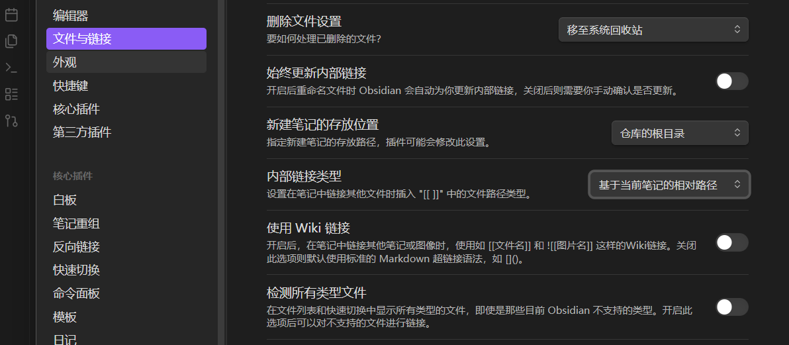
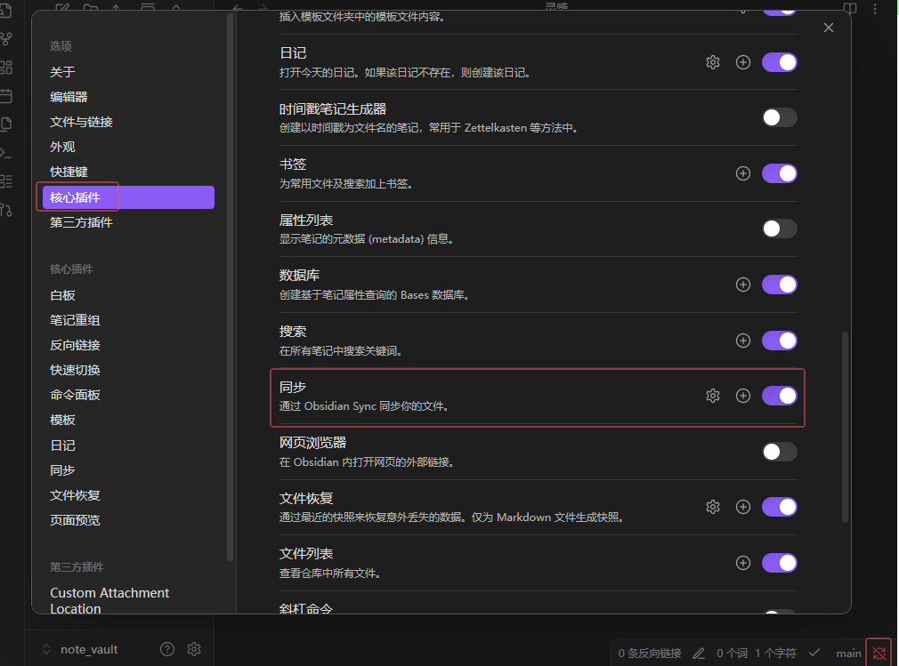

## 基于 Git 云同步

`.gitignore` 添加以下两项，这两个文件会被频繁修改，容易产生无意义的冲突：

```text
.obsidian/workspace.json
.obsidian/workspace-mobile.json
```

推荐配合 obsidian-git 插件使用（插件地址：<https://github.com/denolehov/obsidian-git>）。

## AI

AI 辅助方案有两种：

1. AI Editor（编辑器内直接调用）
2. AI CLI（推荐）

### 以 Gemini CLI 为例

依赖 node.js，先安装一下，多版本并存推荐使用 nvm：

```sh
nvm install latest
nvm use 25.2.1   # 以上面 latest 返回的版本为准
```

官网：<https://geminicli.com/>。其实就一句：

```sh
npm install -g @google/gemini-cli
```

Gemini CLI 的文件搜索功能较弱，可以考虑结合本地 AI 工具来弥补。

## 图片管理

Obsidian 可以直接从外部粘入图片，默认是自有的 Wiki 链接格式（`![[xxx.png]]`），不是标准的 markdown 文件格式。在「设置 → 文件与链接」中关掉它：



再配合插件 Custom Attachment Location，按笔记归档附件：

```text
assets/${noteFileName}/${generatedAttachmentFilename}
```

## 关闭右下角官方同步

如果只用 Git 同步，可以把右下角的官方同步入口关掉，避免误触：


